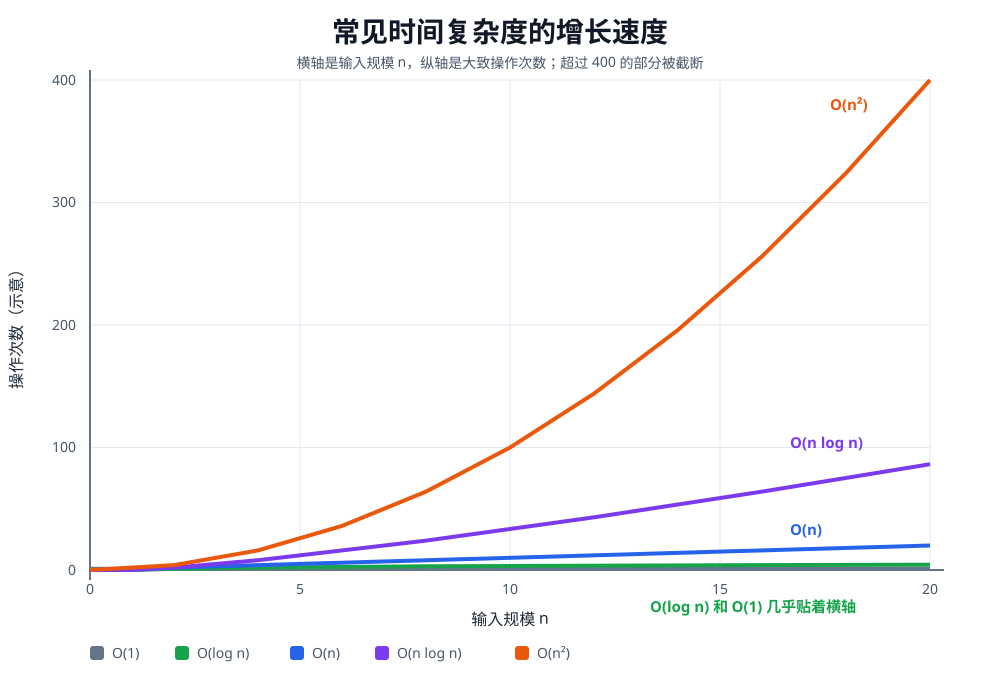
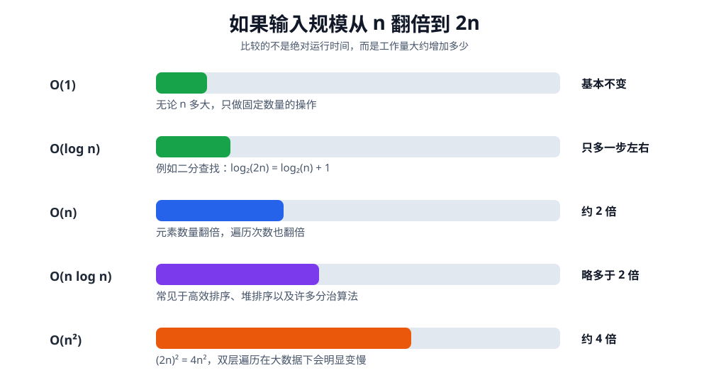

# 算法时间复杂度与函数图像

这份笔记用于复习常见时间复杂度的性能差异。理解复杂度时，不要只背 `O(n)`、`O(log n)` 这些符号，而要观察：**随着输入规模 `n` 增大，算法的操作次数增长得有多快。**

## 1. Big O 表示什么

假设一个算法处理 `n` 个元素大约需要执行 `f(n)` 次基本操作，那么我们使用 Big O 描述 `f(n)` 的增长速度。

例如：

```go
for i := 0; i < n; i++ {
	// 固定操作
}
```

循环执行 `n` 次，所以时间复杂度是：

```text
O(n)
```

Big O 主要关心输入变大后的增长趋势，通常忽略：

```text
常数倍
低次项
具体机器速度
```

例如：

```text
3n + 10      → O(n)
5n² + 2n + 1 → O(n²)
```

这不代表常数完全不影响实际运行时间，只表示分析大规模输入时，最高增长项起主要作用。

## 2. 常见复杂度的增长曲线



从快到慢通常排列为：

```text
O(1)
  ↓
O(log n)
  ↓
O(n)
  ↓
O(n log n)
  ↓
O(n²)
```

这里的箭头表示：当 `n` 足够大时，越往下增长越快，通常性能越差。

## 3. 每种函数图像的直觉

### 3.1 `O(1)`：水平直线

无论输入规模多大，操作次数基本不变：

```go
value := nums[0]
```

函数可以近似看作：

```text
f(n) = 1
```

图像是一条水平线。

常见操作：

- 数组根据下标访问元素。
- 哈希表平均情况下查询一个 key。
- 查看堆顶元素。

### 3.2 `O(log n)`：增长越来越慢的曲线

每一步都把剩余问题缩小为原来的一部分，最常见的是每次缩小一半：

```text
n → n/2 → n/4 → n/8 → ... → 1
```

例如 `n = 1,000,000`，二分查找大约只需要比较 `20` 次：

```text
log₂(1,000,000) ≈ 20
```

常见操作：

- 二分查找。
- 平衡二叉搜索树的查找。
- 堆的一次插入或弹出。

为什么复杂度中通常不写对数的底数？因为不同底数之间只相差一个常数倍，而 Big O 会忽略常数倍：

```text
log₂n、log₁₀n、ln n 都写成 O(log n)
```

### 3.3 `O(n)`：斜直线

输入增加多少，操作次数大致就增加多少：

```go
for _, value := range nums {
	_ = value
}
```

`n` 翻倍，工作量通常也翻倍。

常见操作：

- 遍历一次数组。
- 遍历一次链表。
- DFS 或 BFS 访问树中的每个节点一次。

### 3.4 `O(n log n)`：直线与平方之间

可以理解为：

```text
需要处理 n 个元素
每个元素对应大约 log n 层操作
```

常见算法：

- 归并排序。
- 堆排序。
- 快速排序的平均情况。
- 向大小为 `n` 的堆中插入 `n` 次。

### 3.5 `O(n²)`：抛物线

常见于两层循环都和 `n` 有关：

```go
for i := 0; i < n; i++ {
	for j := 0; j < n; j++ {
		// 执行 n × n 次
	}
}
```

`n` 翻倍时：

```text
n² → (2n)² = 4n²
```

所以工作量大约变成原来的 `4` 倍。

常见算法或场景：

- 暴力比较所有元素对。
- 冒泡排序、选择排序、插入排序的最坏情况。
- 某些二维动态规划。

## 4. 使用具体数字比较

下面把复杂度近似看成操作次数，只用于理解增长差异：

| `n` | `O(1)` | `O(log₂n)` | `O(n)` | `O(n log₂n)` | `O(n²)` |
|---:|---:|---:|---:|---:|---:|
| 10 | 1 | 3.3 | 10 | 33 | 100 |
| 100 | 1 | 6.6 | 100 | 664 | 10,000 |
| 1,000 | 1 | 10 | 1,000 | 9,966 | 1,000,000 |
| 10,000 | 1 | 13.3 | 10,000 | 132,877 | 100,000,000 |
| 1,000,000 | 1 | 20 | 1,000,000 | 约 20,000,000 | 1,000,000,000,000 |

当 `n = 1,000` 时：

```text
O(n)       ≈ 1,000 次
O(n log n) ≈ 10,000 次
O(n²)      = 1,000,000 次
```

当 `n = 1,000,000` 时：

```text
O(log n)   ≈ 20 次
O(n)       = 100 万次
O(n log n) ≈ 2,000 万次
O(n²)      = 1 万亿次
```

这就是为什么数据规模较大时，`O(n log n)` 和 `O(n²)` 的实际性能可能相差非常大。

## 5. 输入规模翻倍时会怎样



可以用“输入翻倍测试”快速感受复杂度：

| 复杂度 | `n` 变成 `2n` 后 | 直觉 |
|:--|---|---|
| `O(1)` | 基本不变 | 与输入规模无关 |
| `O(log n)` | 只增加一个常数量级的步骤 | 每次砍掉一半 |
| `O(n)` | 约 `2` 倍 | 遍历的数据翻倍 |
| `O(n log n)` | 略多于 `2` 倍 | `n` 和 `log n` 都增加 |
| `O(n²)` | 约 `4` 倍 | `(2n)² = 4n²` |

## 6. 怎样从代码看出复杂度

### 6.1 一层循环不一定就是 `O(n)`

普通遍历：

```go
for i := 0; i < n; i++ {
}
```

执行 `n` 次，所以是 `O(n)`。

但如果每次乘以 `2`：

```go
for i := 1; i < n; i *= 2 {
}
```

变化过程是：

```text
1 → 2 → 4 → 8 → 16 → ... → n
```

所以是 `O(log n)`。

### 6.2 两层循环不一定就是 `O(n²)`

如果两层都完整执行 `n` 次：

```go
for i := 0; i < n; i++ {
	for j := 0; j < n; j++ {
	}
}
```

复杂度是：

```text
O(n × n) = O(n²)
```

但是下面这种双指针：

```go
left := 0
right := 0

for right < n {
	right++

	for 某个条件 {
		left++
	}
}
```

虽然代码中出现了嵌套循环，但 `left` 和 `right` 都最多移动 `n` 次，总复杂度仍可能是 `O(n)`。

所以不要只数循环层数，要数每个变量总共移动了多少次。

### 6.3 先后执行的复杂度相加，保留增长最快的项

```go
// O(n)
for i := 0; i < n; i++ {
}

// O(n²)
for i := 0; i < n; i++ {
	for j := 0; j < n; j++ {
	}
}
```

总复杂度：

```text
O(n + n²) = O(n²)
```

### 6.4 嵌套执行通常相乘

```text
外层执行 n 次
每一次外层，内层执行 log n 次

总次数 = n × log n
复杂度 = O(n log n)
```

### 6.5 递归要看分支数和递归深度

二分查找每次只进入一个规模减半的分支：

```text
T(n) = T(n/2) + O(1)
结果：O(log n)
```

归并排序进入两个规模减半的分支，并在每层处理 `n` 个元素：

```text
T(n) = 2T(n/2) + O(n)
结果：O(n log n)
```

## 7. 如何根据数据范围判断是否会超时

下面只是刷题中的粗略经验，不是绝对规则：

| 输入规模 | 常见可考虑的复杂度 |
|---:|---|
| `n <= 1,000` | `O(n²)` 可能可行 |
| `n <= 100,000` | 通常需要 `O(n log n)` 或 `O(n)` |
| `n <= 1,000,000` | 通常优先考虑 `O(n)` 或 `O(log n)` |

实际是否超时还会受到语言、常数、内存访问、测试数据和时间限制影响。

## 8. 空间复杂度

空间复杂度描述算法额外使用的内存随 `n` 如何增长。

例如创建长度为 `n` 的数组：

```go
result := make([]int, n)
```

额外空间复杂度是：

```text
O(n)
```

只使用几个变量：

```go
left := 0
right := len(nums) - 1
```

额外空间通常是：

```text
O(1)
```

递归调用栈也要计算空间。例如平衡二叉树递归深度约为 `log n`，调用栈空间是 `O(log n)`；退化成链表的树，调用栈可能达到 `O(n)`。

## 9. 复杂度分析的常见误区

### 9.1 `O(n log n)` 不是 `O(n × n)`

当 `n = 1,000`：

```text
n log₂n ≈ 10,000
n²       = 1,000,000
```

二者相差约 `100` 倍。

### 9.2 Big O 相同，不代表实际速度完全一样

两个算法都是 `O(n)`，但一个每个元素执行 `2` 次操作，另一个执行 `100` 次操作，实际运行时间仍然可能不同。

Big O 描述增长趋势，不是精确秒数。

### 9.3 小规模输入时，简单算法可能更快

当 `n` 很小时，`O(n²)` 算法可能因为代码简单、常数小而比复杂的 `O(n log n)` 算法更快。但随着 `n` 增长，增长更慢的算法通常会取得优势。

### 9.4 最坏、平均和最好复杂度不同

例如快速排序：

```text
平均时间复杂度：O(n log n)
最坏时间复杂度：O(n²)
```

题目没有特别说明时，通常优先关注最坏时间复杂度。

## 10. 最后总结

先记住增长顺序：

```text
O(1) < O(log n) < O(n) < O(n log n) < O(n²)
```

再记住输入翻倍后的变化：

```text
O(1)       → 基本不变
O(log n)   → 只增加一点
O(n)       → 约 2 倍
O(n log n) → 略多于 2 倍
O(n²)      → 约 4 倍
```

分析代码时，不要机械地数循环层数，而要问：

> 当输入规模从 `n` 增加到 `2n` 时，这段代码的总操作次数大约会变成多少？
